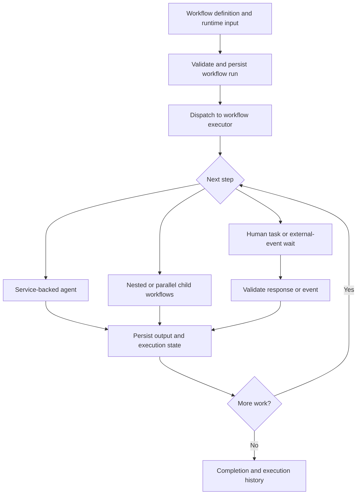

# RetiLaw

**A legal practice platform in development, combining immigration workflows, document intelligence, a custom workflow engine, and a Flutter mobile app.**

Built by [Rajesh Amara](https://github.com/rajeshamara), founder and hands-on solutions architect.

> **Documentation-only public showcase.** This repository presents selected product capabilities, architecture, and engineering decisions for portfolio review and demonstration. The application source remains private. No application code, credentials, client data, deployment configuration, or internal development records are distributed here.

RetiLaw brings matter information, supporting documents, form preparation, and team responsibilities into a connected application. Its current focus is immigration practice, including employment-based matters, USCIS and Department of Labor form preparation, and controlled assistance with the FLAG portal. Attorneys and firm staff remain responsible for review and consequential decisions.

## Explore the project

- [Product capabilities](#product-capabilities)
- [Custom workflow engine](#custom-workflow-engine)
- [RetiLaw mobile app](#retilaw-mobile-app)
- [Architecture and technology](#architecture-and-technology)
- [Engineering and validation](#engineering-and-validation)
- [My role](#my-role)
- [Development status](#development-status)

## The problem

Immigration work moves information between client records, matter screens, supporting documents, forms, reviewers, and external portals. Re-entering the same facts creates extra work, while disconnected task lists make it difficult to see what a matter is waiting for and which information has already been reviewed.

RetiLaw is being built around a connected process: organize authoritative matter data, collect missing evidence, prepare forms from structured information, route work to the appropriate person, and retain the state needed to continue later. The engineering challenge spans both short automated operations and business processes that wait for people or outside events.

## Product capabilities

The private development codebase contains the following capabilities. Individual components and complete legal workflows have different levels of integration and validation; this overview does not imply general availability.

| Area | Engineering work represented |
| --- | --- |
| Matter workspace | Attorney-facing matter screens, client and employer relationships, tasks, documents, and workflow visibility. |
| Document intake | Document requests, supporting-evidence collection, structured extraction, and review of information used by downstream work. |
| Form preparation | Shared mapping and generation services for USCIS and Department of Labor forms, applicant-specific data, saved form snapshots, preview, and PDF output. |
| Workflow orchestration | A custom engine that coordinates service-backed agents, human tasks, nested processes, and external events. |
| AI-assisted information access | Retrieval-augmented generation (RAG), chatbot integration, structured extraction, and model-provider adapters. |
| Identity and access | Shared authentication, multifactor authentication, company membership, product permissions, and role-aware application behavior. |
| Mobile access | A Flutter app with shared account controls and an authorized, read-only matter directory. |
| Portal assistance | RetiLaw-to-FLAG transfer components, with user review and controlled interaction with the external portal. |

## Custom workflow engine

The workflow engine is a custom Python implementation for persistent business processes. It separates **what a process does** from **how each capability is implemented**: a definition composes reusable agents, an executor advances the process, backend services perform the business operations, and persisted records describe the work completed or still waiting.

An agent is a reusable capability adapter; it does not have to invoke an AI model. Document requests, deterministic form generation, notifications, and HTTP data acquisition can participate alongside model-assisted work. This lets a process use ordinary application logic where the answer is known and AI where interpretation adds value.

The following diagram is a conceptual view of the engine, rather than a deployment map:

### Definitions, data, and composition

| Capability | Implemented behavior |
| --- | --- |
| Declarative definitions | JSON definitions describe a workflow's name, description, version metadata, inputs, tasks, and output mapping. Registered definitions can be loaded from repository assets or object storage. |
| Input contracts | Required-field and basic top-level type checks reject unsuitable input before execution. |
| Context and parameter binding | Steps consume original inputs, earlier step results, and the current item within a loop; outputs become available to later work. |
| Sequential execution | Ordered steps compose a process from smaller capabilities. |
| Conditional routing | If/else branches and exact-match switch branches, including defaults, select the next work from runtime data. |
| Collection processing | Serial loops repeat a task sequence over a collection. |
| Concurrent execution | Parallel task blocks run independent work concurrently. |
| Nested workflows | A workflow can call another reusable workflow with explicit inputs and mapped results, retaining parent/child relationships. |
| Durable parallel children | Child workflow identities and parent join state are persisted. Children can pause independently; the parent continues when all children complete. |
| Reusable service adapters | Agents expose focused business capabilities through the service layer, allowing the same underlying behavior to serve workflows and APIs. |

Definitions express a reusable process; matter-specific people, organizations, and facts enter as runtime data. This supports different legal scenarios without embedding a particular client's information in a workflow template.

### Human work and external events

Long-running processes need explicit waiting states. A document request or attorney review should remain meaningful after the user closes a browser.

- **Persistent human tasks:** a checkpoint can carry a role, an optional named assignee, an action, a UI form, instructions, a due date, and input/output data.
- **Controlled completion:** task completion checks the assigned reviewer, actionable state, and expected output. Required approval checkpoints cannot simply be skipped.
- **Artifact-specific review:** selected form and package review services bind a decision to the saved artifact being reviewed, keeping the approval connected to that version of the work.
- **External-event waits:** a process can wait for a specified event and check its type, source, matter, actor, owner, and required payload values before continuing.
- **Duplicate-event handling:** event acceptance and rejection are recorded, and repeated deliveries are detected, helping prevent a repeated notification from advancing the same wait twice.
- **Workflow-driven communication:** reusable email and document-request capabilities support template selection, conditional send/skip decisions, and delivery results. Document requests include suppression of unchanged requests and an explicit resend path.

### Execution, persistence, and recovery

The API persists a workflow instance before dispatching work to a separate executor. Dispatch adapters support local HTTP execution and Google Cloud Tasks. The executor has concurrency limits and reports active and waiting capacity.

Persistent workflow and task records carry inputs, outputs, status, timestamps, errors, execution identity, parent/root tracking, and relevant company, product, and matter context. Atomic execution claims and state checks guard against concurrent delivery, already-running instances, and inappropriate advancement of paused or terminal work.

Recovery is explicit and capability-specific. Implemented paths include retrying an initial dispatch, recovering selected children that have not started, and assessing supported deterministic preparation retries against retained attempt, version, and content-hash evidence. These paths preserve the workflow identity so recovery remains connected to the original run.

### Visual exploration and monitoring

The application provides a workflow explorer and execution monitor:

- Searchable, paginated workflow definitions with expandable nested task trees.
- Condition and branch inspection, per-node properties, input details, and a JSON view.
- Workflow start and refresh controls.
- Workflow and agent execution lists with status, timestamps, errors, and final messages.
- Root-only or all-instance views, tracking-based drilldown, hierarchical execution trees, and graph views.
- Matter-specific workflow queries that connect a business record to its running processes.

The active interface emphasizes inspection, starting work, and understanding execution. A complete visual authoring and publishing experience is a separate development direction.

### Applying the engine to legal work

An illustrative process is: collect matter inputs, request missing documents, wait for the client's response, extract relevant information, prepare a form, obtain attorney review, and continue to the next approved step. The engine provides the composition and waiting mechanisms; domain services define the documents, data requirements, permissions, and review rules.

Concrete reusable capabilities already exist for onboarding, document requests, form generation, and notifications. Broader immigration workflows continue to be integrated and validated. A workflow definition by itself is not evidence that every legal step or external filing is automated.

**Current engine boundaries:** durable parallel child workflows use a wait-for-all join; collection loops run serially. Recovery supports defined continuation paths, rather than arbitrary replay from any failure. Version metadata does not imply immutable version pinning for every run. A general recurring scheduler, configurable automatic retry/backoff policy, and complete no-code publishing are not claimed as delivered capabilities.

## RetiLaw mobile app

RetiLaw includes a mobile application built with **Flutter and Dart**, with Android and iOS project integration. The current product milestone brings authenticated, company-scoped matter visibility to a phone.

### Current functionality

| Capability | Current development behavior |
| --- | --- |
| Sign-in | Shared native account controls use password and time-based one-time password (TOTP) verification in the development authentication flow. |
| Company selection | A signed-in user selects an authorized company; backend access checks apply company membership, product entitlement, and tenant roles. |
| Matter directory | Displays the authorized matter count and each matter's name, client, and employer where present. |
| Session handling | Protected session storage, server validation on restoration, refresh, logout, and switch-user behavior are shared capabilities. |
| Local unlock | Shared device-authentication support can unlock a protected existing session; it does not replace server authentication or authorization. |
| Refresh and recovery | Loading, empty, error, and retry states are explicit. Refresh makes a new request, and failed reads clear stale matter data. |
| Reusable presentation | The same product screen is used by the standalone RetiLaw app and when hosted within the RetiPlatform mobile app. |

The current matter experience is **read-only**. Matter editing, detail actions, and offline matter caching are outside this milestone. Current mobile session issuance is restricted to the development environment; the release authentication target is system-browser OAuth Authorization Code with PKCE.

### How the mobile app was developed

The mobile work follows the platform's reuse-first approach. RetiLaw is a thin product application over shared Flutter packages, with product-owned screens, typed models, and services. It consumes backend APIs instead of duplicating business rules or accessing databases directly.

| Shared layer | Responsibility |
| --- | --- |
| Core | Shared platform-neutral types and runtime configuration contracts. |
| UI | Shared themes, account controls, and reusable presentation components. |
| Network | HTTP transport, authenticated requests, session orchestration, serialization, and transport errors. |
| Identity | Credential contracts, protected storage, and local device-authentication integration. |
| Environment and configuration | Explicit environment selection and non-secret configuration shared through typed interfaces. |

The application flow is **screen → product service → shared network service → backend API**. Flutter widgets manage presentation; services handle use cases; native Android and iOS adapters provide platform-specific storage and authentication capabilities. The backend remains responsible for access to company and matter data.

Development progressed through concrete milestones:

1. **Establish the app and shared workspace:** create the Flutter product shell, product identity and branding, shared packages, and independent app entry points.
2. **Connect to real APIs:** add explicit environment configuration, HTTPS connectivity, visible request results, and failure/retry handling.
3. **Build shared identity:** implement account controls, MFA, protected sessions, restoration, logout, and optional local device unlock behind reusable interfaces.
4. **Add the first legal use case:** implement the authorized matter directory with a typed product service and reuse the backend's existing matter-visibility rules.
5. **Validate actual journeys:** combine static analysis and unit/widget tests with installed Android app interactions, preserved-data upgrades, session transitions, network failures, and physical-device checks.

Shared packages let improvements to authentication, transport, and presentation serve multiple mobile products while keeping each product's legal or business behavior separate. RetiLaw can run independently; companion apps are not required installations.

### Mobile validation and release scope

Development records include Android emulator validation of standalone and RetiPlatform-hosted matter journeys, plus standalone RetiLaw testing on a physical Android phone over Wi-Fi. This is evidence for those exercised paths, not a claim that every mobile feature or device combination is validated.

iOS integration is present, but RetiLaw-specific iOS acceptance, production authentication, release signing, and store distribution remain separate delivery gates. This repository does not distribute an APK or iOS build or announce app-store availability.

## Architecture and technology

RetiLaw is a product built on shared RetiPlatform capabilities. Identity, workflow orchestration, documents, communications, and reusable service contracts provide the foundation; RetiLaw adds matter behavior, legal forms, evidence handling, and practice-specific workflow composition.

| Area | Technology or approach |
| --- | --- |
| Web application | React, TypeScript, and Vite, with shared components and product-specific screens. |
| Runtime UI configuration | Node.js serves product route, menu, and role configuration. |
| Backend | Python, FastAPI, and typed Pydantic request/response models. |
| Workflow runtime | Custom Python orchestration, declarative JSON definitions, separate execution service, and local/cloud dispatch adapters. |
| Persistence | PostgreSQL, with company databases, product schemas, workflow state, and versioned business records. |
| Document storage | Google Cloud Storage integrations for documents and generated artifacts. |
| AI integration | Structured extraction, RAG, tool-using agents, and a common client with multiple model-provider adapters. |
| Mobile | Flutter and Dart, shared workspace packages, and native Android/iOS integration. |
| Validation | Backend tests, frontend component tests, Playwright role-based journeys, Flutter unit/widget tests, and emulator/device validation. |

Web and mobile share backend business capabilities while retaining their own presentation layers. Backend requests follow **router → service → data access**, and frontend requests follow **component → service → request transport**. This keeps authorization and business integrity at service boundaries and reduces duplicate implementations.

## Engineering and validation

**Reuse authoritative information.** Document and form work uses structured source data and saved generated snapshots. Preview and output should describe the same prepared form, with review attached to the relevant artifact.

**Compose reusable capabilities.** Domain differences belong in mappings, configuration, typed adapters, and workflow definitions when the underlying behavior is shared. New practice areas should build on existing services instead of creating a parallel engine.

**Keep AI work bounded and reviewable.** Deterministic services handle known rules and data transformations. Model-assisted extraction and interpretation participate in explicit workflows with validation and human review where required.

**Separate identity from access.** Being signed in does not itself grant access to every company, product, or matter. The architecture distinguishes identity, membership, entitlement, role, and resource-level permission.

**Validate the user journey.** Tests cover service contracts and workflow state transitions, while browser and device checks exercise the actual interface. Shared changes require regression checks for existing consumers. An emulator pass, physical-phone pass, and iOS pass are treated as different evidence.

**Make incomplete work visible.** Implemented components, exercised scenarios, and release readiness are tracked separately. This is particularly important for long-running workflows, document output, authentication, and mobile delivery.

## My role

I lead product direction, solution architecture, implementation, integration, and technical validation. My work spans the React application, Python services, PostgreSQL data model, custom workflow runtime, document and AI capabilities, and the shared Flutter mobile architecture.

I use AI-assisted engineering tools for implementation, refactoring, debugging, and test automation while retaining responsibility for architecture, code review, and validation. The development approach emphasizes reusable capabilities, explicit contracts, and evidence from real application journeys.

RetiLaw demonstrates how I translate domain requirements into a connected product across web, mobile, services, data, access controls, and applied AI.

## Development status

**RetiLaw is under active development.** The workflow engine and mobile foundations are implemented engineering work; the complete legal platform remains a work in progress.

Current development priorities include integrating broader immigration lifecycles, strengthening document/form review and workflow recovery, extending mobile capabilities beyond read-only matters, and completing platform-specific release validation. Additional practice areas are a longer-term direction, not part of the delivered scope described here.

This repository will remain a curated documentation showcase as the private product develops. It is not an installable application distribution or a source-code release.

For professional background and other public work, visit [my GitHub profile](https://github.com/rajeshamara).
