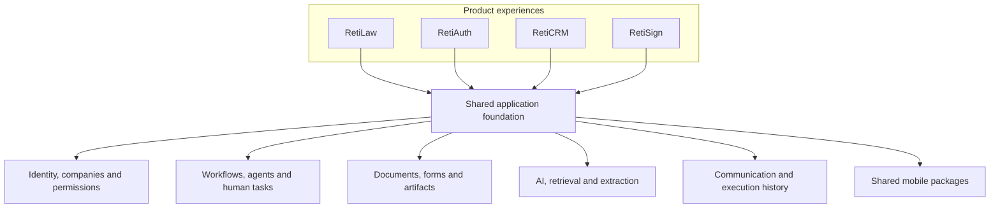

# RetiPlatform

**A platform built on a single-app architecture, with multiple products developed on a shared application foundation.**

RetiPlatform brings identity, company access, workflow orchestration, documents, forms, communications, AI integration, and mobile infrastructure into one reusable foundation. RetiLaw, RetiAuth, RetiCRM, and RetiSign apply those capabilities to different business needs, with their own screens, permissions, data, and product behavior.

The central idea is to build a capability once and make it useful across products. A document service, human approval step, authentication flow, or form-generation capability can serve several experiences through a shared contract. Product differences are expressed through focused services, configuration, mappings, and workflow composition.

> **Documentation-only public showcase.** This repository describes the platform's capabilities, architecture, and development approach. Application source code remains private. The products are under active development; the linked pages distinguish current implementation, recorded validation, and future direction.

## Products built on the platform

| Product | Purpose | Explore |
| --- | --- | --- |
| **RetiLaw** | Legal practice and immigration work: matters, client and employer information, document collection, form preparation, review, and mobile matter visibility. | [RetiLaw](products/retilaw/README.md) |
| **RetiAuth** | Login, MFA, company-aware sessions, OAuth client access, delegated-authorization foundations, and a Flutter authenticator for local one-time codes. | [RetiAuth](products/retiauth/README.md) |
| **RetiCRM** | Relationship and business operations: accounts, contacts, campaigns, leads, sales pipelines, purchasing, and payment records. | [RetiCRM](products/reticrm/README.md) |
| **RetiSign** | Electronic-signature preparation, recipient participation, document signing, and evidence handling. | [RetiSign](products/retisign/README.md) |

Each product has a distinct scope and maturity. The product pages explain the features present today and the areas still being developed.

## What single-app architecture means

The web products share a React application shell and a Python/FastAPI application foundation. Runtime product configuration supplies routes, menus, and role-based navigation. Shared services handle common capabilities; product modules supply the behavior that belongs to their domain.

Single-app architecture describes application reuse and composition. The system still has separate runtime responsibilities, including UI configuration, API requests, workflow execution, persistence, and object storage. Mobile products use a shared Flutter workspace and the same backend capabilities, with independent application entry points.

The following diagram shows the logical relationship between products and shared capabilities:

Products are designed to remain independently usable and separately entitled. Shared identity does not grant access to every company or product. Product data stays within its authorized context, and composition that spans products belongs to RetiPlatform.

## Shared capabilities

| Capability | What it provides |
| --- | --- |
| **Custom workflow engine** | Declarative processes, conditional branches, loops, concurrent work, nested workflows, durable parallel children, human tasks, external-event waits, execution history, and defined recovery paths. |
| **Identity and tenancy** | Shared authentication, MFA, company membership, product entitlement, role administration, and company-aware sessions. |
| **Documents and forms** | Document intake and extraction, structured source resolution, reusable mappings, saved form snapshots, preview, PDF output, and artifact-specific review. |
| **Reusable agents** | Typed adapters that expose backend services to workflows, including deterministic operations and model-assisted work. |
| **AI integration** | Common model-provider interfaces, retrieval-augmented responses, extraction, tool-calling loops, and usage metadata. |
| **RetiBot** | Shared web assistant for product help and general questions, with an action-planning prototype, confirmation controls, and command-path integration under development. |
| **Communication** | Reusable email templates, document requests, conditional notifications, and delivery results within business processes. |
| **Shared web framework** | Runtime product navigation, reusable components, product-owned screen composition, and consistent service boundaries. |
| **Mobile foundation** | Flutter packages for configuration, UI, networking, protected identity, and session handling across standalone and platform-hosted experiences. |

See the [client-onboarding and EB-2 PERM execution screenshots](platform/workflow-engine.md#execution-examples) for concrete examples of the workflow monitor, nested processes, and per-step status tracking.

## Explore the architecture

The main README introduces the platform. These chapters provide the implementation detail without repeating it in every product page.

| Chapter | Topics |
| --- | --- |
| [Platform architecture](platform/README.md) | Single-app structure, runtime responsibilities, product boundaries, technology, and extension model. |
| [Custom workflow engine](platform/workflow-engine.md) | Definition contracts, execution, human decisions, events, persistence, recovery, and monitoring. |
| [Identity and tenancy](platform/identity-and-tenancy.md) | Identity versus authorization, company databases, product roles, SSO context, and delegation direction. |
| [Documents and forms](platform/documents-and-forms.md) | Intake, source ownership, mapping, snapshots, output, and review. |
| [AI and reusable agents](platform/ai-and-agents.md) | Service-backed agents, provider adapters, retrieval, bounded tool use, and review boundaries. |
| [RetiBot](platform/retibot.md) | One shared assistant for command proposals, product help, and general knowledge. |
| [RetiBot intent-to-command architecture](platform/retibot-intent-execution.md) | Intent catalogs, saved plans, confirmation, execution boundaries, guardrails, and implementation status. |
| [Mobile architecture](platform/mobile-architecture.md) | Flutter workspace, shared packages, native integration, development milestones, and validation. |

## How the platform grows

A new product starts with the existing application, identity model, navigation framework, and service contracts. It adds product permissions, domain data, screens, and workflows. A new legal practice area can add terminology, intake definitions, document requirements, rules, and form mappings while reusing the same underlying engines.

For example, RetiLaw combines document collection, structured extraction, form generation, and attorney review. RetiSign applies shared document and PDF capabilities to field placement and signing. RetiAuth supplies authentication experiences and a mobile authenticator. RetiCRM applies the platform foundation to relationship management and business operations. Shared changes are validated against the consumers they affect.

## Engineering and development status

The implementation uses **React, TypeScript, Vite, Node.js, Python, FastAPI, Pydantic, PostgreSQL, Google Cloud Storage integrations, Flutter, and Dart**, alongside a custom workflow runtime and model-provider adapters.

The engineering approach separates presentation, business services, and persistence; keeps known transformations deterministic; records durable workflow state; and ties review to the relevant data or artifact. Validation combines focused backend and frontend tests with browser journeys and mobile emulator/device checks where applicable.

Feature implementation, successful validation of a particular journey, and release availability are tracked separately. This repository documents those distinctions and the platform's development direction; it does not distribute installable applications or announce general availability.
