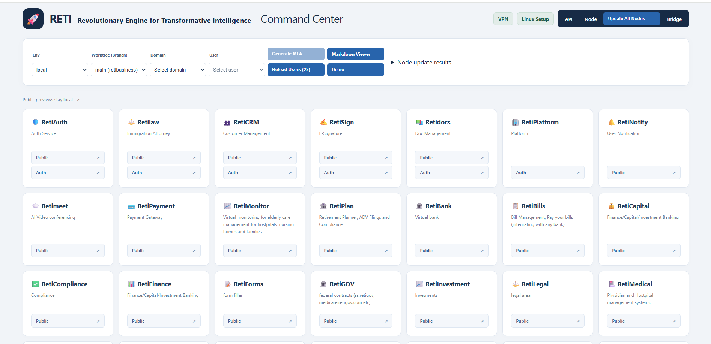

# Development infrastructure and delivery

[RetiPlatform home](../README.md)

RetiPlatform's engineering environment connects development machines, permanent Git worktrees, private networking, browser automation, mobile toolchains, and deployment tooling. It supports parallel work on shared platform capabilities and individual products while keeping each assignment tied to a checkout, a branch, and validation evidence.

The development fleet spans **Windows, three Linux development machines, and a Mac mini** for iOS development and validation. RetiMesh and RetiControl connect the private environment. A custom Command Center makes the configured environments and product entry points accessible from one place.

This infrastructure supports the same reuse model as the application: common setup, networking, worktree conventions, and validation procedures serve multiple products. The chapters below describe the implementation and recorded operating practices, with planned extensions identified where they matter.

## Explore the engineering environment

| Chapter | What it covers |
| --- | --- |
| [Development environment](development-environment.md) | Machine roles, permanent worktrees, configuration, Command Center, and integration across the fleet. |
| [RetiMesh and RetiControl](retimesh-and-reticontrol.md) | The customized private network built around Tailscale and Headscale, peer connectivity, service placement, and recovery. |
| [Build and deployment](build-and-deployment.md) | Local validation, private product hosting, GCP public-site delivery, environment boundaries, and release checks. |
| [Mobile development and validation](mobile-validation.md) | Linux and Mac mini responsibilities, dedicated mobile lanes, automated checks, emulators, and physical Android and iPhone testing. |
| [AI-assisted development](ai-assisted-development.md) | Codex and Claude Code, worktree ownership, architecture guidance, model qualification, task reporting, and evidence of completed work. |

## Command Center

The Command Center is a development launcher for navigating the platform across environments and worktrees. Its selectors connect an environment, a configured branch, a company/domain context, and a test user to the relevant product experience. API and Node shortcuts, setup guides, documentation access, and development authentication helpers support repeatable daily work.

*Screenshot of the working development launcher. The product cards include public previews and future product concepts alongside implemented applications; a launcher entry does not imply a released product. The [product pages](../README.md#products-built-on-the-platform) describe the four products featured in this showcase.*

Environment and worktree choices come from shared configuration. Product links adapt to the selected context, while public previews retain their local preview route. **Update All Nodes** requests runtime configuration reloads across configured Node instances and reports individual outcomes, including failures and timeouts. It does not deploy application code.

The Command Center and the **RetiAgents Worktree Dashboard** have different roles. The launcher opens the appropriate tools and applications. The dashboard presents assignments reported by development agents, including the host, worktree, agent, status, and start/completion times. Those explicit task reports provide visibility into parallel work; they do not infer process health or decide that a branch is ready to merge.

## From an assignment to a validated change

Development starts in an assigned worktree with its own branch and configured service and browser-debugging ports. The agent or developer reads the applicable architecture contracts, identifies the shared consumers affected by the change, and implements within that scope.

Validation follows the behavior being changed: backend contracts, web builds and Playwright journeys, saved data and generated documents, or installed mobile applications. Worklogs record implementation and validation, and task reports preserve assignment status. A published branch then enters the separate integration process: explicit release for merge, comparison with the current main branch, conflict checks, one-branch-at-a-time integration, and validation of the resulting state.

The [development environment chapter](development-environment.md) explains the tooling that coordinates these steps across machines. The [AI-assisted development chapter](ai-assisted-development.md) explains how the same expectations apply to different coding agents and newly introduced models.

## Delivery and device testing

The delivery environment has several destinations. Authenticated product services have a private-host deployment path, public marketing sites have a GCP deployment path, and mobile clients have platform-specific build and device-validation paths. The [build and deployment chapter](build-and-deployment.md) explains how these fit together without treating every destination as one automatic promotion pipeline.

Mobile work uses shared Flutter packages while relying on the appropriate host tools for each platform. Linux supports Android and shared application development; the Mac mini supplies Xcode and iOS validation. Testing combines automated checks, Android emulators, iOS Simulator runs, and validated physical Android and iPhone journeys. See [mobile validation](mobile-validation.md) for the development and testing approach.

## Engineering practices demonstrated

| Area | Concrete practice |
| --- | --- |
| Parallel development | Persistent worktree assignments, separate branches and runtime ports, and explicit ownership of shared changes. |
| Private infrastructure | Customized VPN clients and control service, documented service state, and recovery procedures. |
| Integration | Machine-local working-state checks, published-branch comparison, conflict forecasting, and serialized main-branch integration. |
| Reproducibility | Shared setup procedures and environment configuration, including platform-specific toolchain requirements. |
| Validation | Automated browser journeys, backend checks, mobile builds, device tests, and retained evidence for defined scenarios. |
| AI engineering | Architecture-guided implementation, bounded assignments, model qualification exercises, and review of observable results. |

These pages describe the infrastructure supporting an actively developed platform. Recorded acceptance applies to the named environment and journey. It is separate from a claim that every product, machine, or release target has completed the same validation.

Continue with [platform architecture](../platform/README.md), [automated testing and quality](../platform/testing-and-quality.md), and [security and client isolation](../platform/security-and-isolation.md).
