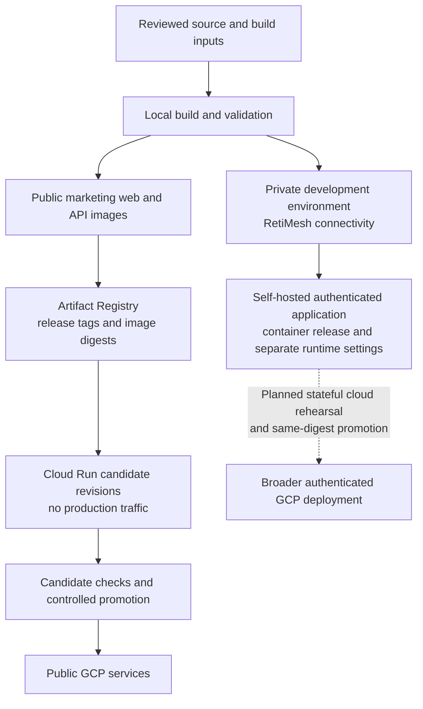

# Build and deployment

RetiPlatform's delivery approach connects local development, a private network of development machines, production-style container validation, and cloud releases. Build artifacts, runtime configuration, data environments, and public routing are treated as distinct parts of a release.

Two deployment tracks are documented today: **public marketing web/API services on Google Cloud Run**, and **the authenticated application on a self-hosted Linux runtime**. The broader goal is to validate stateful releases privately and promote the same reviewed image digests into cloud environments. That complete promotion pipeline remains an architectural direction rather than an implemented release gate for every product.

[Platform overview](../README.md) · [Infrastructure overview](README.md) · [Development environment](development-environment.md) · [RetiMesh and RetiControl](retimesh-and-reticontrol.md) · [Mobile validation](mobile-validation.md)

## From local work to a release

Development takes place in explicit repository checkouts with isolated runtime ports. The private network connects development machines and shared services; it provides a practical environment for building, testing, and investigating application behavior across hosts.

Production-style releases package selected application source and compiled assets separately from the development checkout. Runtime credentials and environment settings are supplied separately. This makes the source revision, build output, deployment configuration, and data target independently reviewable.

These are related engineering stages, not a claim that every GCP request traverses the private VPN or that every local change automatically deploys.

## Self-hosted authenticated application

The current deployment definitions build the shared frontend, backend, Node configuration service, and workflow dependencies from the monorepo. A multi-stage Docker build compiles the Vite frontend, then assembles the runtime with its required application modules and assets.

The recorded release has three application containers:

| Runtime role | Responsibility |
| --- | --- |
| Product | Container nginx serves compiled frontend assets and proxies the Node configuration service and FastAPI API; supervisor manages these processes |
| Workflow | Reuses the application image with a separate executor entry point and listener |
| Notifications | Reuses the application image with the notification service entry point |

PostgreSQL and Redis run as native host services, with separate development and production-style instances/configuration. The Linux rehearsal deliberately uses **host networking with loopback application listeners**. It does not implement a separate container bridge for each role or dedicated physical infrastructure per client.

Runtime configuration is mounted read-only outside the image. Compose specifies restart behavior, resource limits, rotated logs, and role-specific health checks. These checks establish process/service readiness at their tested boundaries; a healthy workflow or notification container is not evidence that a complete business workflow has passed.

Source staging selects application directories and excludes development artifacts and sensitive file categories. Private runtime configuration is excluded from the Docker build context. The recorded deployment tooling is tied to reviewed release bundles, and some installers are deliberately fresh-install or one-time migration tools. They are not a general rolling-update system.

## Public ingress and request routing

The authenticated application's public request path has two nginx layers:

1. Cloudflare receives browser HTTPS traffic and forwards it through the configured tunnel.
2. A native nginx gateway receives the tunnel connection over verified origin TLS and selects the application destination.
3. The application container's nginx serves compiled assets and forwards permitted configuration and API requests.
4. Backend services access the selected environment's database, cache, storage, and external integrations.

Public hostname identity is preserved because the application uses the company/product hostname as part of request context. The network socket destination, HTTP Host, and TLS server name have separate roles. Moving an upstream to loopback must preserve the intended application identity and certificate validation.

The product proxy restricts the browser-facing Node configuration surface, separates API paths from static navigation, and keeps missing assets from silently becoming SPA HTML responses. Application authentication and tenant authorization remain service responsibilities; proxy configuration alone does not establish complete endpoint protection.

Public development access is a separate routing adapter. It uses explicitly registered hostnames, identity/origin mappings, development service destinations, and a distinct browser-cookie contract. Its gateway translates configuration and callback URLs so the browser can remain on the public development origin. Additional tenant/product hostnames require routing and certificate coverage; wildcard DNS alone is insufficient.

Gateway changes have their own lifecycle: save the previous configuration, validate the candidate, install the reviewed files, validate the installed configuration, reload the affected gateway, and verify the intended public route. The native and container nginx configurations must be checked independently.

## GCP public web and API releases

The public marketing deployment has a smaller application boundary than the authenticated suite:

- A React/Vite web build served by nginx.
- A separate FastAPI public API, including the contact-request flow.
- A same-origin web proxy to the API.
- Container images published to Google Artifact Registry and deployed to separate Cloud Run services.
- Runtime secret mounting through Secret Manager for the contact-email integration.

The public API Dockerfile runs the application as a non-root user. Credentials are supplied at runtime rather than copied into that image. The web container receives its API upstream through runtime configuration, while compiled static assets remain part of the release image.

The implemented publishing script checks the local images and destination registries, applies a shared release tag, and pushes the images. **Publishing images and deploying Cloud Run are separate operations.** Recorded releases deploy exact image digests into no-traffic candidates, validate them, then explicitly shift service traffic. Previous revisions remain available as rollback targets.

August 2026 release evidence includes local container checks, candidate health and proxy checks, browser validation, and a controlled contact submission that exercised web, API, and email delivery. A September 2026 web-only release records candidate desktop/mobile checks, compiled-asset hash comparison, live-domain verification, traffic allocation, and a retained rollback revision. These are release-specific records, not proof that every product or integration has been deployed to GCP.

## Acceptance and recovery

A release needs evidence at several boundaries:

| Boundary | Evidence to establish |
| --- | --- |
| Build | Identifiable source/build inputs, expected artifacts, and successful dependency/build checks |
| Runtime | Correct process roles, configuration, listeners, and dependency readiness |
| Routing | Intended hostname reaches the intended environment with valid TLS and correct redirects |
| Application | Login, MFA where applicable, session reload, role-specific behavior, and the selected business journey |
| Regression | Existing routes and representative shared consumers continue working |
| Recovery | Previous image/configuration retained, compatible data state, and an explicit restoration procedure |

Recorded authenticated acceptance includes login and dashboard reload, along with separately reported application errors. A landing-page or probe response is not a substitute for production database health or authenticated workflow acceptance. [Testing and quality](../platform/testing-and-quality.md) describes the broader validation structure.

Gateway rollback restores the reviewed configuration; GCP rollback can redirect traffic to a retained revision. Application rollback also depends on schema and configuration compatibility. Reverting an image does not undo database writes or external effects such as email and signature requests. Data restore and recovery-time guarantees require their own exercises.

## Current boundaries and next steps

The public GCP path is still an operator-driven release process. Dedicated deployment/runtime identities, the full cloud development-to-production promotion pipeline, and broader stateful cloud acceptance remain follow-up work. The self-hosted application also retains a shared host, storage, power, and connectivity failure domain; no high-availability or proven disaster-recovery guarantee is implied.

The intended next cloud stage reuses reviewed images, configuration contracts, migrations, and acceptance cases while separately validating managed database behavior, private workflow dispatch, secrets, storage, concurrency, and recovery. It cannot be established by copying a Compose definition into Cloud Run.
