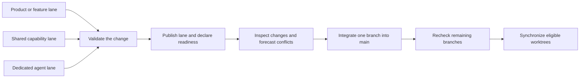

# Development environment

[Infrastructure overview](README.md) | [RetiPlatform home](../README.md) | [AI-assisted development](ai-assisted-development.md) | [Mobile validation](mobile-validation.md)

RetiPlatform development uses a Windows control workstation and a fleet of Linux and macOS machines. Permanent Git worktrees give product, feature, and engineering tasks separate branches and application ports while keeping a common integration path through `main`. A browser-based Command Center makes the selected environment, worktree, company context, and product easier to navigate.

This chapter describes the configured development environment and its operating process. Machine registration, running services, and successful product validation are tracked separately.

## Development fleet

The development fleet consists of **one Windows workstation, three Linux development machines, DevMac running macOS, and a Mac mini**. Each machine has a defined role in the shared development and validation workflow.

| Environment | Role in the development setup |
| --- | --- |
| Windows workstation | Interactive development, Command Center access, and the primary `main` integration checkout. It coordinates inspection and synchronization of the configured development lanes. |
| `minipc` — Linux | Parallel product and feature worktrees, including the mobile backend integration lane, worktree32. |
| `lenovo` — Linux | Additional permanent worktrees for independent product and feature development. |
| `lenovo1` — Linux | Additional permanent worktrees, extending the capacity for concurrent engineering assignments. |
| `devmac` — macOS | Permanent development worktrees for product and feature engineering in the macOS environment. |
| `macmini` — macOS | Dedicated iOS development, Xcode builds, Simulator testing, and physical iPhone validation. |

Machine aliases identify development hosts. The worktree registry assigns development lanes to their machines, and the [mobile validation chapter](mobile-validation.md) explains how Android and iOS toolchains support emulator and physical-device testing.

## Worktree allocation and memory planning

The shared registry assigns permanent worktrees to each machine. The numbered development worktrees are allocated as follows:

| Machine | Numbered development worktrees |
| --- | ---: |
| Windows workstation | 13 |
| `minipc` | 19 |
| `lenovo` | 8 |
| `lenovo1` | 4 |
| `devmac` | 4 |
| `macmini` | 8 |
| **Total** | **56** |

These counts exclude the main checkout on each machine. Windows uses main for integration; the other machines maintain main as a reference alongside their assigned development worktrees. Worktree registration provides a persistent place for an assignment, and application stacks are started as needed.

Capacity planning allocates **approximately 2 GB of RAM per active worktree's application processes**. This allowance helps determine how many development stacks to run on a machine. The budget also reserves room for the operating system, shared services, coding clients, browser sessions, build activity, and mobile emulators. Available memory, CPU load, and swap activity inform the final concurrency choice.

The 2 GB figure is a planning allocation for an active service stack. Git worktree directories share repository objects on their host and consume disk space; they acquire a runtime memory footprint when services, builds, or tests are running. Configured worktree count and active-stack count are therefore tracked separately.

## Permanent product and feature lanes

A lane is a persistent Git branch and working directory assigned to an owner. It can support a product, a reusable platform capability, an individual feature, or a validation stream. Codex and Claude Code operate within assigned lanes, including dedicated Claude Code worktrees, under the same repository architecture and completion rules.

The arrangement supports parallel work without requiring agents to edit the same checkout. Its main boundaries are:

- **Checkout identity:** work begins by verifying the Git root, branch, and commit. An unexpected checkout or detached branch is a blocker.
- **Working files:** each assignment stays within its own source tree. Another lane is not a fallback source directory.
- **Runtime ports:** the central port registry assigns web, Node configuration, API, and workflow ports per lane. Each lane also reserves a separate browser-debugging port block for role-specific test profiles.
- **Ownership:** independent agents use distinct lanes. When one owner maintains copies of the same lane on more than one machine, edits and check-ins must be serialized and reconciled through published commits.
- **Evidence:** worklogs and handovers use the lane identity, so one agent's continuation notes do not overwrite another's.

Port separation helps browser tests reach the intended version of the application and prevents two lanes from sharing the same debugging endpoint. It does not create a separate copy of every external dependency: shared datastores, object storage, and other services still require explicit test-data and access boundaries.

## Dedicated ports for independent development and testing

Worktree registration reserves a complete service-port set in the central port registry and associates the lane with its machine. The set includes the web application, Node configuration service, API, workflow executor, and a block of 50 browser-debugging ports. Registration checks the service ports and entire browser block for collisions with existing assignments.

For example, two configured lanes on MiniPC have the following allocations:

| Service | `worktree31` | `worktree32` |
| --- | ---: | ---: |
| Web application | 3031 | 3032 |
| Node configuration service | 4031 | 4032 |
| FastAPI application | 8031 | 8032 |
| Workflow executor | 9031 | 9032 |
| Browser debugging block | 10650–10699 | 10700–10749 |

Startup helpers resolve these values from the selected checkout's registration. Machine hostnames identify the development host, while the port identifies the worktree's service. Products running inside one lane reuse that lane's application foundation.

Each agent can edit and build its own branch, use its service processes, and target its own browser-debugging ports. Separate role-specific browser sessions keep cookies, browser storage, and navigation separate. An agent testing a change in worktree32 therefore has a distinct application and browser endpoint from an agent working in worktree31.

The isolation combines **working files, branch ownership, service ports, browser sessions, and process ownership**. Shared databases and external integrations retain their own tenant, record, and test-data boundaries. This lets agents develop and exercise separate application versions while coordinating changes to common resources.

## Starting a worktree

A prepared worktree has its branch, dependencies, runtime configuration, and registered ports in place. Starting that lane follows a consistent sequence:

1. **Select the checkout.** Work begins in the assigned machine and worktree, with its repository root and branch confirmed.
2. **Resolve the environment.** Startup helpers identify the worktree and load its web, Node, API, workflow, and browser-debugging ports from the registry.
3. **Check the prerequisites.** The Linux/macOS launcher checks the required tools and entry points, then reuses an existing session for that worktree or checks that the lane's service ports are available before creating one. Windows opens the configured tabs, with environment setup handled by the service scripts.
4. **Start the lane's processes.** Separate terminals or tmux windows run the web application, Node configuration service, API, and workflow process from that checkout. A command window remains available for builds, tests, and Git work.
5. **Open and validate the selected environment.** The Command Center selects the machine and lane. Service checks and the appropriate browser journey confirm that the running application responds as expected.

The repository provides platform-specific entry points, invoked from the selected worktree:

| Host | Startup entry point | Workspace organization |
| --- | --- | --- |
| Windows | `.\start\start_worktree.bat` | Windows Terminal tabs for commands and the four application processes. |
| Linux or macOS | `bash start/start_worktree.sh --detach` | A named tmux session for the worktree, with commands and service windows that remain available after SSH disconnects. |

Runtime ports are selected automatically from the configured lane. When creating a new session, the Linux/macOS launcher reports an occupied service port instead of replacing the process using it. Process inspection and targeted restarts stay scoped to the owning worktree, preserving other agents' running environments.

For browser testing, the agent uses the worktree's assigned debugging block and the required role-specific profile. Tests then reach that lane's application version, use its browser session, and retain their results with the same checkout. Together, these conventions support concurrent implementation and validation across the fleet.

## Windows Command Center

The Command Center is a development launcher with selectors for **environment**, **worktree/branch**, **company domain**, and **test user**. It combines the registered machine assignments and port catalog to construct the relevant application links. The [infrastructure overview](README.md) includes a screenshot.

| Control | Development purpose |
| --- | --- |
| Environment and worktree selectors | Choose a registered host and one of its configured lanes before opening a product. |
| Company and user selectors | Establish the intended test context for product authentication and role-specific journeys. |
| Product cards | Open authenticated product entry points or local public previews. |
| Shared-service links | Reach API documentation, Node service checks, and supporting development tools. |
| Runtime configuration refresh | Request reloads from configured Node instances and report each success, failure, or timeout separately. |
| Setup and test utilities | Provide access to setup guidance, the Markdown viewer, the demo entry point, and controlled test-account helpers. |

Environment selection changes development routing; fixed public environments use their own domain-based routing. Public preview links retain their separate local preview destination. Product tiles are navigation entries and may include future offerings; a tile is not evidence that a product has been released.

The Command Center simplifies access to an existing environment. It does not itself prove that a destination is healthy, that a user is authorized, or that the selected application has passed its acceptance checks. Service availability and application behavior are verified at their own boundaries.

## Integration through one main branch

Parallel development converges through `main`. Worktree branches reconcile with the accepted main state rather than merging directly into one another.

The repository has tooling for local and remote Git status, meaningful uncommitted changes, published-branch comparison, conflict forecasting, upstream preparation, and coordinated synchronization. These answer different questions: a clean working directory does not prove all commits are pushed, and a conflict-free merge forecast does not prove the application works.

The integration process requires a branch owner to release an exact, validated branch tip. One ready branch is merged at a time; the remaining branches are compared again against the updated main state. A moved branch tip, unexpected conflict, failed validation, or incomplete host report requires attention before that branch proceeds.

Synchronization distributes an accepted main commit during a coordinated maintenance window. It uses configured lane assignments, checks local working state, and preserves failures as explicit results. An unreachable host is an incomplete inspection. Active work and unpublished changes are not treated as disposable state.

## Service and tooling ownership

Windows application service startup and shutdown are user-operated. On Linux and macOS, an authorized agent may manage the active lane's development stack through the repository's documented launchers after checking process identity and ports. This policy keeps a repair on one lane from restarting another lane's services.

Development-box preparation similarly separates registration from readiness. Host assignment and reserved ports establish an inventory; dependencies, credentials, certificate trust, application startup, and an actual login journey establish additional evidence. Historical setup records describe specific tested machines and journeys, not unlimited concurrency or permanent health guarantees.

The public repository contains the architectural description and selected screenshots. Private connection configuration, test identities, credentials, and operational scripts remain outside this showcase. For the engineering gates applied within each lane, continue to [AI-assisted development](ai-assisted-development.md) and [testing and quality](../platform/testing-and-quality.md).
