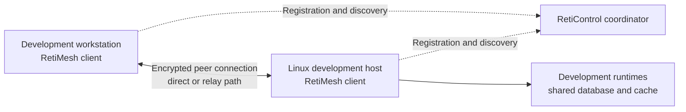

# RetiMesh and RetiControl

RetiMesh and RetiControl provide the private networking foundation for RetiPlatform's development environment. They connect Windows, Linux, and macOS machines so development tools and shared services can communicate through an enrolled device network.

RetiMesh is a customized client built on the **Tailscale open-source engine**. RetiControl is a customized coordinator built on **Headscale**. The work builds on those projects' networking and coordination capabilities, including the WireGuard-based data plane. RetiPlatform's additions cover service integration, service and state ownership, build provenance, packaging, migration, and a native Windows companion.

[Platform overview](../README.md) · [Infrastructure overview](README.md) · [Development environment](development-environment.md) · [Build and deployment](build-and-deployment.md)

## How the network fits together

The client daemon maintains the device's private network connection. Its command-line interface exposes connection state and operational controls. The coordinator handles registration, peer discovery, address allocation, and network policy. Application traffic follows the client's direct or relay paths; it does not all pass through the coordinator.

The September 2026 deployment record covers five enrolled machines across Windows, Linux, and macOS. Migration to the customized clients and coordinator preserved their existing device identities and network addresses. This continuity matters because applications, service dependencies, and remote development access already relied on that network. Later additions to the development fleet require their own networking acceptance; the five-node record does not establish their status.

The coordinator's HTTPS ingress is separate from the Cloudflare Tunnel used for public websites and applications. Private peer connectivity and public browser ingress have separate configuration, certificates, service ownership, and validation. The [deployment page](build-and-deployment.md) follows the public request path.

Network membership provides connectivity. SSH still requires its own authentication, and protected product actions still require application identity, company membership, entitlement, and resource authorization. See [security and isolation](../platform/security-and-isolation.md).

## What the customization includes

| Area | Implemented work |
| --- | --- |
| Maintained source | Pinned Tailscale and Headscale source snapshots, with original provenance and third-party notices retained |
| Product executables | RetiMesh command-line client and daemon; RetiControl server executable |
| Operating-system ownership | Product service names, state directories, local API sockets or pipes, Windows registry locations, adapter identity, and related platform resources |
| Linux integration | Managed client and coordinator services, with protected persistent state and explicit service dependencies |
| macOS integration | Client daemon managed through launchd, with its own state and local control socket |
| Windows integration | RetiMesh service, product-owned installation/state locations, and a separate desktop tray companion |
| Build evidence | Toolchain and upstream pins, source-file hashes, build commands, binary metadata, and output checksums |
| Migration and recovery | Recorded identity-preserving migrations, retained prior binaries/configuration, and component-specific rollback records |

The build tooling supports Linux, Windows, and macOS client targets on amd64 and arm64; the coordinator targets Linux. Compilation targets are broader than the currently packaged and deployed combinations. Existing development package assemblers focus on Linux and Windows amd64.

The source overlay records the specific operating-system resources changed for product ownership. It also disables the upstream package-replacement path in product builds. A controlled RetiMesh update distribution mechanism remains further work.

## Windows tray experience

The Windows companion is implemented in C# with Windows Forms. It runs as a normal desktop application alongside the installed daemon and provides:

- Connection status, the device's private address, and a peer list with online/offline state.
- Address copying, manual refresh, and periodic status refresh.
- Connect and disconnect controls for an existing enrolled profile.
- Optional per-user startup at sign-in.
- A window that can close into the notification area while the connection continues.

The tray resolves the command-line executable from the installed service, checks the expected installation boundary, invokes it without a shell, and limits execution time. Connection controls recheck the daemon's current state before acting. States that require setup or attention disable those controls and show an inline message.

Connecting resumes the saved profile; disconnecting changes the connection while leaving the daemon service running. Quitting the tray also leaves the VPN connection alone. The tray does not collect login credentials or provide account switching, exit-node selection, or a complete network administration console.

## Shared services and lifecycle

The private network supports development access to shared PostgreSQL and Redis services on the Linux host. Development and production-style data services have distinct instances/configuration. Network-dependent service startup is explicitly ordered around the client interface becoming available, rather than assuming the private address exists as soon as the machine starts.

Build, package assembly, installation, enrollment, and migration are separate steps. A successful build records the inputs and outputs; it does not install or connect a device. Package verification checks inventory and hashes. Checksums identify changed files but do not replace publisher signatures.

The repository also contains isolated lab packaging and lifecycle tooling. These packages use separate state and service ownership, refuse conflicting installations, and keep installation distinct from service startup. Lab enrollment uses fresh identities and an independent controller configuration. Host-specific migration scripts are retained as migration records rather than general-purpose installers.

Recovery preserves device identity, controller state, configuration, and previous artifacts. A working local-network management path is part of the recovery approach when the private network itself is unavailable. Restoring a component requires checking its current state so a rollback does not overwrite newer registrations or configuration.

## Validation and current scope

September 2026 deployment records report all five nodes online after migration, preserved identities, SSH connectivity, client-service restart recovery, name resolution, and development database/cache TCP reachability. Those checks establish the recorded networking milestone; TCP reachability alone does not prove authenticated database operations or complete application workflows.

The Windows tray has recorded build, parser/state, rendered-interface, and read-only live-status checks. Live disconnect/reconnect and sign-in startup changes were deliberately left outside that automated acceptance run.

The broader validation plan covers fresh enrollment, allowed and denied traffic, direct and forced-relay paths, IPv4/IPv6, operating-system DNS and routes, suspend/resume, reboot, coexistence, upgrades, removal, and recovery. The current pilot does not establish completion of that entire matrix. In particular, coordinated full-host reboot testing, outside-network/cellular acceptance, controlled signed installers and updates, and a macOS menu-bar experience remain open.

The authenticated **RetiShield dashboard is a separate preview**. Its shared login, navigation, and product registration do not yet provide live device discovery, controller administration, network-policy editing, or RetiAuth SSO integration with the deployed mesh. Android and iPhone RetiMesh clients also remain a separate implementation and acceptance effort. Relay infrastructure independence has not been established; upstream-hosted relay dependencies must be identified when validating that requirement.
