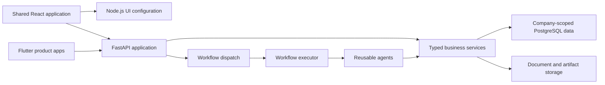

# Platform architecture

[RetiPlatform home](../README.md)

RetiPlatform uses a single-app architecture to develop multiple products on a common technical foundation. The shared application provides the entry points, runtime configuration, UI patterns, business-service boundaries, and infrastructure integrations. Products compose these capabilities into distinct experiences.

## Application structure

| Layer | Responsibility |
| --- | --- |
| Product experience | Domain screens, product terminology, product-specific behavior, and workflow composition. |
| Shared web application | React shell, navigation, common components, request services, and registered screen sections. |
| Runtime UI configuration | Product routes, menus, component references, and role-based route visibility served by Node.js. |
| Shared API application | FastAPI routers and typed request/response contracts for common and product capabilities. |
| Business services | Authorization, domain rules, data transformations, transaction boundaries, and reusable operations. |
| Workflow runtime | Persistent process state, execution, service-backed agents, human waits, and external-event coordination. |
| Persistence and storage | PostgreSQL company databases and product schemas, plus object-storage integrations for documents and artifacts. |
| Mobile clients | Flutter product apps and shared packages that consume backend services. |

The web client currently calls FastAPI for business requests and Node.js for runtime UI configuration. Routing all business traffic through Node.js is a future architectural direction, rather than the current request path.

This is a logical architecture diagram. A single application foundation can have several runtime processes; deployment layout and product boundaries are separate concerns.

## Product boundaries and reuse

RetiLaw, RetiAuth, RetiCRM, and RetiSign share platform capabilities while retaining their product responsibilities. The architecture requires products to remain usable without installing or purchasing another product.

Shared behavior is exposed through stable services and components. Product modules do not integrate by directly calling another product or joining its tables. When a business process spans products, RetiPlatform owns that composition and its authorization requirements.

The same distinction applies within a product. RetiLaw practice areas can vary in forms, terminology, evidence, rules, and process order while sharing document services, the workflow engine, identity, persistence, and UI primitives.

| Kind of change | Appropriate location |
| --- | --- |
| A capability with the same meaning across products | Shared platform service or component. |
| Different fields, terminology, templates, or process order | Configuration, mappings, typed adapters, or workflow definitions. |
| Behavior unique to a product | A focused product implementation behind its service boundary. |
| A process spanning several products | Platform-owned orchestration. |

These are architecture rules. Adoption of a shared contract and validation of individual product flows are described on the relevant product pages.

## Runtime navigation and screen composition

Product UI configuration registers route identifiers, URL paths, component names, navigation items, and per-role route access. React resolves registered components and builds the product's navigation from that configuration.

Some screens combine shared and product-owned sections. A typed registration mechanism assigns each section an owner and controls its eligibility and loading. The shared shell handles presentation and loading/error states; the product supplies its own sections. This supports reuse of account or profile presentation without making every product load another product's domain screens.

Navigation reflects permissions. Server-side checks remain responsible for enforcing access to business data and commands.

The shared shell also hosts [RetiBot](retibot.md), reusing the chatbot component and service path across product experiences. Its knowledge-answering and action-proposal behaviors share one input. The [intent-to-command architecture](retibot-intent-execution.md) describes the existing controls and the remaining execution integration.

## Service and data contracts

Web requests follow **component → frontend service → request transport**. Backend requests follow **router → business service → data access**. Mobile uses **screen → product service → shared networking → API**.

Typed models define requests and results. SQL belongs to the data-access layer, and tenant database selection comes from validated request context. The architecture keeps a screen from becoming a second implementation of authorization, form generation, or business persistence.

Workflow agents use the same business services as API entry points. This allows an operation to be triggered interactively or within an automated process while retaining one service-owned implementation.

## Security and company boundaries

Product and company subdomains give each experience a distinct entry point into the shared application. The session separates parent identity from signed company/product context. The main authentication-cookie helper applies `HttpOnly`, `Secure`, and `SameSite=Strict`; destination access still depends on company membership, product entitlement, roles, and resource permissions.

Business data uses one PostgreSQL database per client, with product schemas inside that database. Application services and the central platform registry remain shared. This provides a separate tenant data store for each client without requiring a separate application deployment for every company.

The [security and client isolation chapter](security-and-isolation.md) explains these layers, cookie-policy differences, and the distinction between a product subdomain and an authorization boundary. [Identity and tenancy](identity-and-tenancy.md) describes the access model and onboarding responsibilities.

## Workflow-owned business processes

Multi-step work often lasts longer than a browser session. The workflow layer records what has started, which steps have finished, what is waiting for a person, and which event can resume execution.

Screens collect input and show server state. Services enforce authorization and business integrity. Workflows coordinate the lifecycle, and reusable agents invoke the required services. Ordinary searches, reads, and transient UI interactions do not need a workflow of their own.

The [custom workflow engine](workflow-engine.md) provides these mechanisms. Product adoption is incremental: an existing service or UI flow does not automatically mean its complete lifecycle has moved into the engine.

## Technology and responsibilities

| Technology | Role in the implementation |
| --- | --- |
| React, TypeScript, Vite | Web presentation and product experiences. |
| Node.js | Runtime UI configuration and supporting application services. |
| Python, FastAPI, Pydantic | Backend APIs, business services, and typed contracts. |
| Custom Python workflow runtime | Declarative orchestration and persistent execution. |
| PostgreSQL | Platform records, company data, product schemas, and workflow persistence. |
| Google Cloud Storage | Document and generated-artifact storage integrations. |
| Model-provider adapters | Common access to configured language-model services. |
| Flutter and Dart | Shared mobile packages and independent product applications. |

## Development and validation

The development approach starts with an existing capability and extends its contract where the behavior is shared. Product variation belongs in data and configuration when that preserves a clear model. A reusable service is validated against representative existing consumers as well as the new use case.

Validation is matched to the change: service and workflow tests for business behavior; component tests and browser journeys for web interactions; exact snapshot and rendered-artifact checks for forms; and unit/widget tests plus installed-app journeys for mobile. A test of one consumer or platform is not treated as proof for every other consumer.

Playwright automation exercises actual product screens through documented, role-specific browser sessions. The [automated testing and quality chapter](testing-and-quality.md) explains representative scenarios, assertions, evidence capture, and how recorded results are distinguished from current release acceptance.

The [development infrastructure and delivery overview](../infra/README.md) covers the machines, private network, permanent worktrees, Command Center, coding-agent workflow, deployment paths, and mobile validation environment supporting this architecture.

Continue with [identity and tenancy](identity-and-tenancy.md), [security and client isolation](security-and-isolation.md), [automated testing](testing-and-quality.md), [documents and forms](documents-and-forms.md), [AI and agents](ai-and-agents.md), and [mobile architecture](mobile-architecture.md).
