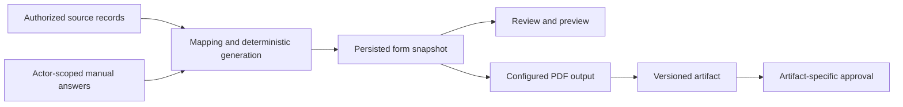

# Documents and forms

[Platform architecture](README.md) | [RetiPlatform home](../README.md)

Documents move through several different activities: collection, extraction, review, generation, signing, and retrieval. RetiPlatform provides shared services for those activities so each product can define its business process without building another document pipeline.

RetiLaw is a major consumer of the form and evidence capabilities. RetiSign uses shared document and PDF infrastructure for preparation and signing. Their business rules and product permissions remain separate.

## Document intake and information extraction

The implementation includes document requests, supporting-evidence collection, storage integration, extraction services, and review surfaces. Requests can participate in a workflow that records what was requested, waits for a response, and continues when the required event or human action arrives.

Structured extraction turns document content into information that downstream services can use. Extracted information still needs the correct owner, business context, and review treatment; the presence of a value in a model response is separate from acceptance as an authoritative fact.

Document-request communication uses reusable templates and explicit send decisions. Unchanged requests can be suppressed, while an intentional resend retains its reason and actor.

## A shared form lifecycle

The core form contract separates live source information from the saved representation of a prepared form.

1. Select the form definition, edition, business record, and relevant applicant or actor.
2. Resolve source information from the authorized context and combine it with current manual answers.
3. Apply mappings, normalization, and deterministic derivations.
4. Persist the prepared form as a versioned snapshot.
5. Preview and render the saved version.
6. Attach applicable review decisions to the actual snapshot or artifact.

The architecture requires preview and output to use the same persisted snapshot. A later profile change is an input to a new generation decision; it should not silently change the meaning of an already prepared form.

## Ownership and mappings

| Concept | Responsibility |
| --- | --- |
| Source | Where a value is retrieved or derived during generation. |
| Canonical field | The business meaning and durable location of the generated value. |
| Output target | Where an adapter places that value in a template. |
| Manual answer | A form-specific response entered by an authorized actor. |
| Reference value | Information owned by a reusable record, such as a person or organization. |
| Derived value | A result calculated from declared inputs and rules. |

This separation lets one business answer populate several output locations without turning template widget names into the data model. Repeatable information remains structured, and a selection can retain the dependent answers that belong to it.

Applicant-scoped generation identifies the person a form belongs to. Principal-only forms and forms for dependents require different ownership rules. Actor-owned professional or certification fields need their own authorized process; an empty template field is not permission for another actor to supply it.

## Output and review capabilities

Current implementation includes shared form-generation services, mapping definitions, saved form data, preview components, PDF-generation paths, and artifact handling. USCIS and Department of Labor forms are important consumers, with different form families and output paths requiring their own validation.

Selected artifact workflows retain metadata such as content hashes, byte lengths, storage generations, and renderer manifests. Review can then refer to the saved bytes and source version instead of an ambiguous latest download. These controls are applied by the relevant artifact services; they are not a claim that every stored document uses the same immutable lifecycle.

PDF viewing and product interaction have distinct responsibilities. The shared viewer supplies the document surface, while products add the appropriate review, placement, or signing controls. [RetiSign](../products/retisign/README.md) describes its specialized document fields and signing experience.

## Why the platform owns this capability

A form's edition, labels, mappings, sources, actor assignments, and output geometry can change while the generation lifecycle remains the same. Those differences belong in definitions and adapters where possible. Shared services retain the behavior for persistence, source resolution, versioning, and output contracts.

API calls and workflow agents use the same form-generation service. A form prepared from a screen and one prepared by a workflow can therefore share the underlying rules and typed request/result model.

## Validation and development scope

Form validation covers separate boundaries: source ownership, manual Save/reload, generated snapshot shape, preview, output values, visible PDF layout, actor permissions, and unaffected records. A persisted value alone does not establish that the downloadable artifact is correct.

The broader form architecture allows additional output adapters and domain families. This page describes the existing document and PDF-focused implementation; it does not claim every planned output format, form, or external filing integration is complete. See [RetiLaw](../products/retilaw/README.md) for its application to legal work.
