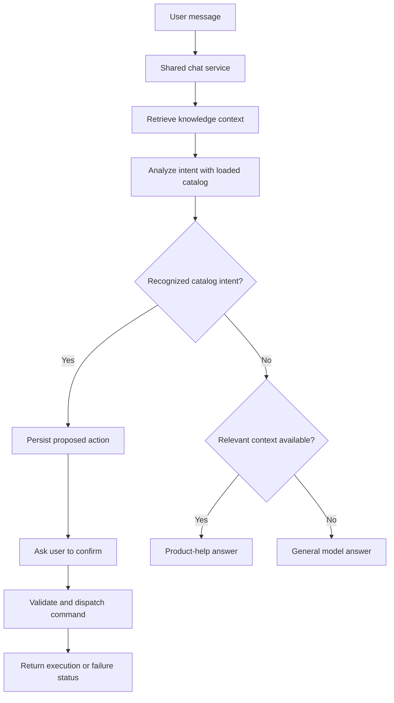

# RetiBot: from intent to command

[RetiBot overview](retibot.md) | [Platform architecture](README.md) | [RetiPlatform home](../README.md)

RetiBot's command architecture separates language interpretation from business execution. A model proposes a known intent; application services retain the plan and control the operation that may follow.

This page explains both the existing implementation structure and the execution contract it is intended to satisfy. The diagrams are architecture views, not a claim of completed runtime acceptance.

## The three-way decision

The same query path handles actions, product help, and general questions. It first retrieves relevant knowledge context, then asks the model to return either a recognized intent or a conversational answer.

The knowledge branch is guided by model instructions; it is not a separate deterministic proof that an answer is supported by the documents. If intent analysis cannot produce a usable result, the router falls back to a retrieval-assisted answering path. That fallback does not dispatch an action.

## 1. Define the command vocabulary

The intent catalog supplies names and descriptions of operations that the classifier may recognize. Definitions also contain parameter descriptions, and the reference action includes confirmation metadata.

The classifier prompt currently uses the catalog's names and descriptions. Application code then checks the returned intent label against the loaded definitions. An unknown label becomes a non-action response, without an execution identifier being offered to the interface.

Recognition and execution require separate implementation steps. Describing a command in the catalog does not install its handler, validate its inputs, or grant permission to run it. The current execution service contains one explicit reference handler, while the catalog describes additional possible intents.

The command vocabulary must therefore be read as a development artifact, rather than a list of universally available product features.

## 2. Produce a structured proposal

The model is asked for a structured response containing an intent label, a parameter object, and an optional answer message. The service parses that response and creates an application action model.

| Information | Purpose |
| --- | --- |
| Intent | Identifies the proposed operation. |
| Parameters | Holds values inferred from the request. |
| Message | Supplies a conversational response when no supported action is proposed. |
| Analysis metadata | Retains available model-usage information during analysis. |

The existing action model accepts a generic parameter object. It does not currently validate that object against each catalog entry's parameter definitions, and those detailed definitions are not included in the classifier prompt. Typed command-specific validation remains required before parameters can be trusted for execution.

There is also no established confidence threshold or missing-field clarification loop in this path. An uncertain request must not be described as safely resolved merely because a model returned a known label.

## 3. Save the plan before requesting execution

The query service persists a proposed action and returns its identifier. The action record has fields for its intent, payload, pending/executed state, identity attribution, and timestamps.

The interface receives a confirmation response and displays the proposed action with **Confirm & Execute**. Recognition alone does not call the execution handler.

The important boundary is the saved plan: the later request refers to an existing action identifier. It does not ask the model to reinterpret a confirmation message or let the browser provide a different executable payload at that point.

The current record structure is a foundation for traceability. Complete attribution to the authenticated user and company, correlation with the originating message, and linkage to the final workflow outcome still need to be completed. A persisted row by itself is not a complete authorization or audit mechanism.

## 4. Confirm and reload the action

On confirmation, the frontend sends the action identifier through its service layer. The backend reloads the record and checks that it exists and is pending.

That state check can reject a later request after the action has been marked executed. It does not provide an atomic execution claim: concurrent requests, interrupted dispatch, and uncertain results require stronger coordination.

The intended execution boundary also needs to recheck authenticated ownership, company context, current product/resource authority, the allowed intent, validated parameters, and the availability of a supported handler. Those are separate checks from the user's confirmation click.

## 5. Dispatch through an application-owned handler

The reference implementation maps an account-activation intent to a named workflow. The handler chooses the workflow; a model-generated name or arbitrary code fragment does not select the operation.

This preserves the platform layering:

**Chat UI → frontend service → API → action service → application-owned handler → workflow or business service.**

The current reference adapter needs alignment with the workflow service's present dispatch contract. Its parameter forwarding and result handling are also limited. It should be treated as an integration foundation, rather than a validated example of a completed email command.

For long-running operations, the [workflow engine](workflow-engine.md) supplies persistent execution, human waits, and status tracking. Starting or accepting a workflow is distinct from completing the business effect. A response must distinguish a saved proposal, accepted dispatch, running process, completed operation, and failure.

## Guardrail coverage

| Control | Current implementation or remaining requirement |
| --- | --- |
| Allowed-intent prompt | The classifier receives the loaded catalog's names and descriptions. |
| Application-level label check | Returned labels are checked against the loaded catalog before an action proposal is offered. Catalog loading currently needs integration correction. |
| Structured parsing | The service parses the model response; unusable analysis falls back to answering without direct dispatch. |
| Explicit UI confirmation | Floating and full-page chat provide a separate confirmation action for a returned plan. |
| Saved-plan retrieval | Execution reloads a plan by identifier rather than accepting a fresh browser command payload. |
| Pending-state check | Existing code checks the saved state; an atomic claim and stronger replay handling remain required. |
| Execution-time allowlist | Revalidation of the allowed intent and exhaustive rejection of unsupported handlers still need strengthening. |
| Parameter validation | Per-command schemas, required fields, allowed values, and target resolution remain required. |
| Authenticated ownership | Binding the plan and its execution to the authenticated actor and company remains incomplete. |
| Product and resource permissions | Command-specific authorization must be enforced at execution; generic UI availability is not proof of that enforcement. |
| Outcome and audit linkage | A complete link from request and confirmation to workflow outcome and effects remains development work. |

The central policy is **only supported, authorized intents may reach business execution**. The current catalog check is one part of that policy. Prompt constraints, model output, and a confirmation button cannot independently establish the full policy.

## Trust boundaries

Four boundaries keep the architecture understandable:

1. **Language to proposal:** user text and model output describe a possible operation. They do not grant authority.
2. **Proposal to authorization:** the server must bind the plan to the current user, company, product, and target records, then validate the command contract.
3. **Authorization to execution:** an application-owned handler invokes an existing capability under its service rules.
4. **Execution to reported outcome:** completion must be based on persisted business evidence, rather than inferred from an assistant's text response.

Retrieved passages are information for answering, not permission to expand the command catalog. The intent allowlist reduces the range of recognized actions, but it does not by itself prove protection against prompt injection or misuse of an otherwise valid action.

## Extending the architecture

A complete new command requires more than a new intent description. The extension contract is:

1. Define the intent and the product/business meaning it represents.
2. Define a typed input contract, including required values and permitted targets.
3. Bind the operation to authenticated company, product, and resource authority.
4. Register a handler that calls an existing service or workflow capability.
5. Present the effective operation and targets for review before confirmation.
6. Preserve plan identity, claim execution safely, and define retry/failure behavior.
7. Record acceptance and final outcome separately, with audit linkage.
8. Validate both the permitted operation and denied/unsupported cases.

This describes the intended completion standard. The current implementation does not yet provide every step as a finished generic command framework.

## Validation scope

This documentation was checked against the shared UI, query service, intent definitions, action persistence, reference handler, and workflow interface. Existing intent-classification scripts are development checks, not proof of complete command authorization or execution acceptance. No live command or model call was run for this documentation update.

End-to-end acceptance needs to cover catalog availability, known and unknown intents, malformed output, missing or invalid parameters, declined confirmation, unauthorized execution, changed permissions, repeated and concurrent confirmation, dispatch failure, and actual business completion. Product-help and general-answer paths also need validation against their expected information boundaries.

See [RetiBot](retibot.md) for the user-facing overview and [identity and tenancy](identity-and-tenancy.md) for the shared authorization contract.
