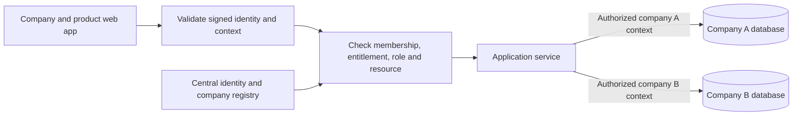

# Security and isolation

[RetiPlatform home](../README.md) | [Platform architecture](README.md) | [Identity and tenancy](identity-and-tenancy.md) | [Testing and quality](testing-and-quality.md)

RetiPlatform combines shared identity services, protected browser cookies, company-specific application context, and a database per company. These mechanisms address different boundaries: authenticating a person, selecting an authorized company and product, and permitting an operation on a particular record.

RetiPlatform is under active development. This chapter distinguishes implemented shared mechanisms from the intended authorization design. Consistent role-based access control (RBAC) across every API operation is a design target; complete endpoint coverage has not yet been implemented or validated.

## One business database per client

Each client company has its own database, created from a common company template. Products organize their business records into schemas within that database. A central platform registry maintains shared identity, company membership, and product entitlements.

This is **single-tenant business-data storage within a shared application architecture**: one business database per company, served by a shared application runtime. It does not imply a dedicated application server, virtual machine, database server, or compute allocation for each client. Product schemas may exist before a product is enabled; entitlement checks determine whether the company may use that product.

The intended protected-request sequence is:

The diagram shows logical request and data boundaries. Ordinary company services consume validated request context. Platform administration has separately bounded authority to manage companies.

## Product subdomains and company context

Company and product addresses make the selected workspace explicit. Illustrative addresses are `company-a.law.example.com` and `company-a.sign.example.com`. The product component selects the application experience; the company component identifies the destination the user intends to enter.

The company database has an immutable internal identity. A later change to the company's public subdomain does not rename that database. Server-side metadata and session handling connect the selected address to the appropriate company; a URL, email suffix, document reference, or storage address is not permission to access its data.

HTTPS sibling subdomains can be **same-site while cross-origin**. An origin includes scheme, host, and port; a site uses scheme and registrable domain. Consequently, SameSite cookie policy does not itself isolate products or companies hosted beneath one parent domain. [Browser site and origin definitions](https://web.dev/articles/same-site-same-origin)

## Browser cookie controls

The shared authentication-cookie helper sets **HttpOnly**, **Secure**, **SameSite=Strict**, and `Path=/`. It resolves the cookie domain from environment configuration so related application hosts can participate in the shared sign-in experience. The same helper issues signed company-context cookies. It retains those attributes in development as well as production; environment-specific domain selection does not automatically relax them.

| Cookie purpose | Current policy |
| --- | --- |
| Shared web identity | HttpOnly, Secure, Strict, with the configured shared domain and explicit path. |
| Company/product context | The same protected attributes, with a distinct cookie name derived from the application origin. |
| Signing invitation session | HttpOnly and Secure, with Lax SameSite behavior and a signing-specific path. It supplements the signing authorization flow. |
| External document integration | HttpOnly; SameSite defaults to Lax and is configurable, as is Secure behavior. Its policy is separate from platform sign-in. |

HttpOnly prevents page JavaScript from reading the cookie; the browser can still attach it to JavaScript-initiated requests. Secure restricts transmission to secure transport. Strict limits sending to same-site requests, while Lax permits certain cross-site navigations. These attributes reduce particular risks rather than establish application permissions. [Cookie attribute semantics](https://developer.mozilla.org/en-US/docs/Web/HTTP/Reference/Headers/Set-Cookie)

Integration, demo, and diagnostic cookies have their own settings. Cookie scope and browser retention are also distinct from the signed session's expiry and authorization rules.

## Validated sessions and independent company tabs

The web application restores server-validated session state before mounting ordinary protected product screens. Cached browser profile information supplies display state; it does not establish authentication. The application does not need JavaScript access to the authentication cookie to ask the server whether the session is valid.

Company entry checks active membership and product entitlement in the central registry before reading the destination company's effective roles. A successful transition issues a signed context containing the destination company and application origin.

That context remains bound to the parent login's identity, session, scope, and expiry. Verification checks its signature and relationship to the parent; a context cookie alone cannot authenticate the user. Origin-specific names keep authorized company tabs from replacing each other's selection. Routes using the shared authentication dependency also reject a mismatched application origin.

The main logout flow expires the shared identity cookie and received company-context cookies using their issuance scope. Server-side cleanup is attempted separately. This describes browser logout behavior, not a guarantee that every independently issued credential is immediately revoked everywhere.

## Authorization and request boundaries

Authentication identifies the caller. Product and resource services are responsible for deciding what that caller may do. Selected implemented examples include RetiSign's active-membership, entitlement, role, and document-assignment checks, and role administration's distinction between platform, company, and product authority. A visible menu or a successful sign-in does not replace these checks. Consistent enforcement across all API operations remains the design target described below.

Request-local context carries the selected database. The request lifecycle clears this routing state after each request, keeping database selection scoped to that request. Authorization remains the responsibility of the applicable authentication dependencies and business services.

SameSite policy and configured CORS origin handling contribute browser-side restrictions. They do not replace current permissions or establish a complete, uniform cross-site request forgery defense. Route-level review and negative tests remain necessary; this implementation is not described as having a universal CSRF-token mechanism.

## API-level RBAC design

> **Design target — implementation in progress.** Existing products have selected role and resource checks. This section describes the intended policy for consistent authorization across API operations, rather than claiming that every endpoint already enforces it.

The goal is to authorize each protected API call against the operation being requested. An operation is identified by its HTTP method and route template: permission to read a record does not automatically grant permission to create, change, approve, or delete it. Each protected operation will declare its required action permission and company/product scope; effective role assignments grant those permissions.

Roles group permissions; the endpoint's action determines which permission must be checked. The following examples illustrate that separation, rather than document an existing permission catalog:

| API operation | Intended authorization requirement |
| --- | --- |
| Read a matter | A role granting matter-read permission in the selected company and product, plus access to that matter. |
| Update a matter | A role granting matter-update permission, plus access to the target matter and any applicable business-state restrictions. |
| Manage product roles | Role-administration permission within the administrator's permitted company and product scope. |

### Authorization on every request

A shared server-side authorization layer is intended to apply the endpoint policy on every request before protected data is returned or a business change is made. The target sequence is:

1. **Authenticate the caller.** Validate the session or other supported credential and establish the trusted identity.
2. **Resolve the authorized context.** Establish the selected company and product, including active membership and product entitlement where required.
3. **Evaluate the operation's policy.** Resolve the user's effective roles and permissions in that context and check them against the API operation's requirement. Role names or permissions supplied by the client do not establish authority.
4. **Check the target resource.** Enforce company ownership, assignment, and other applicable record or business-state rules. A matching role alone does not grant access to another company's data or every record in the same company.
5. **Execute or reject.** Invoke the permitted operation only after the applicable checks succeed. A denied request must not perform the requested business action.

The intended default is to deny access when a protected operation has no matching permission grant. Every endpoint should have an explicit access policy; deliberately public operations, such as starting sign-in, must be identified and reviewed explicitly rather than becoming public through a missing authorization check. A missing endpoint policy must fail closed. An endpoint using a signing invitation, integration credential, or other alternate access mechanism still requires its own explicit policy and credential checks.

The same operation policy is intended to apply whether a request comes from the web application, a mobile app, or a user action initiated through RetiBot. Navigation visibility and chatbot intent selection cannot grant backend authority. Delegated and service callers require their own explicit authorization scope. These principles align with [OWASP's authorization guidance](https://cheatsheetseries.owasp.org/cheatsheets/Authorization_Cheat_Sheet.html).

### HTTP outcomes

| Condition | Intended API response |
| --- | --- |
| Authentication is required, but the credential is missing, invalid, or expired. | **401 Unauthorized**; authentication must be established before the protected operation can proceed. |
| The caller is authenticated, but lacks the required role, permission, membership, entitlement, or resource access. | **403 Forbidden**; the requested operation is refused. |

These outcomes distinguish an authentication failure from an authorization failure. Responses should provide a consistent application error without revealing another company's records, internal policy details, or credentials. HTTP authentication challenges must follow the selected authentication scheme and the requirements for `401` responses. See [HTTP authentication and authorization status semantics](https://www.rfc-editor.org/rfc/rfc9110.html#section-15.5.2).

### Planned acceptance coverage

Completion requires an inventory of endpoint policies and tests for both permitted and denied requests. Planned cases include missing or expired authentication, a valid user with an unsuitable role, read permission without write permission, cross-company and cross-product attempts, access to an unassigned record, and changed or revoked role assignments. Denial checks should verify both the HTTP response and the absence of unauthorized data disclosure or business changes. Explicitly public endpoints and endpoints missing a policy also need coverage.

This is the acceptance direction for API-wide RBAC. It is not a claim that those checks or tests are already complete across the platform.

## Validation and development scope

Security acceptance needs both permitted and denied journeys: valid session restoration, expired or altered sessions, company-context mismatch, missing membership or entitlement, unsuitable roles, unassigned records, company switching, and logout. Existing automated cases cover shared-cookie attributes, logout, and company-session behavior. See [testing and quality](testing-and-quality.md) for browser and backend coverage and execution limits.

Adoption of the shared authorization contract is validated per product and journey. For example, [RetiBot's command architecture](retibot-intent-execution.md) records unfinished ownership and authorization work. The mechanisms described here do not establish complete endpoint coverage or production acceptance.
