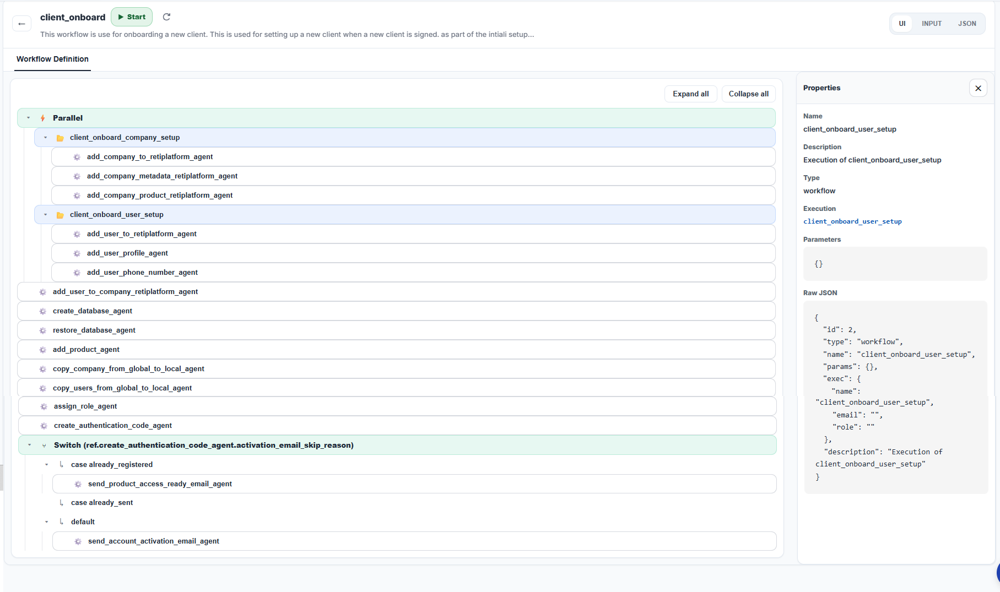
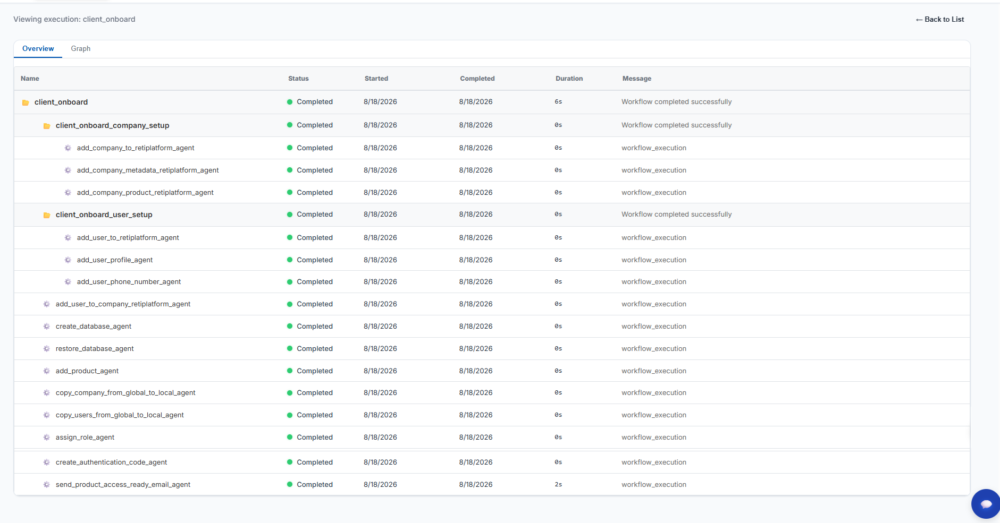
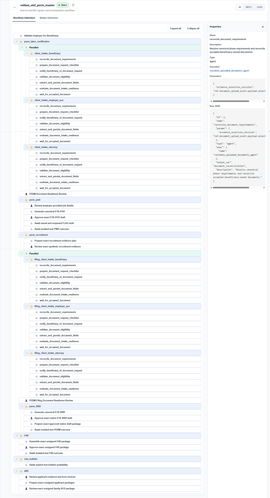
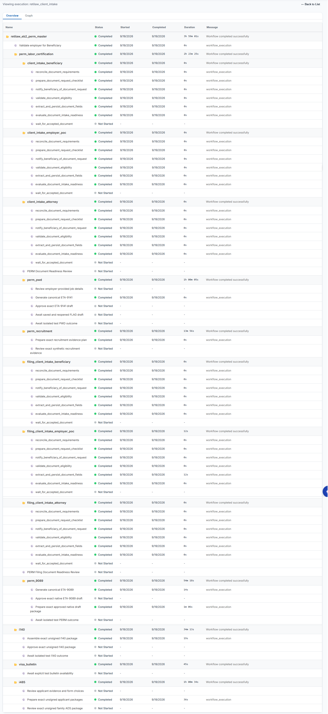
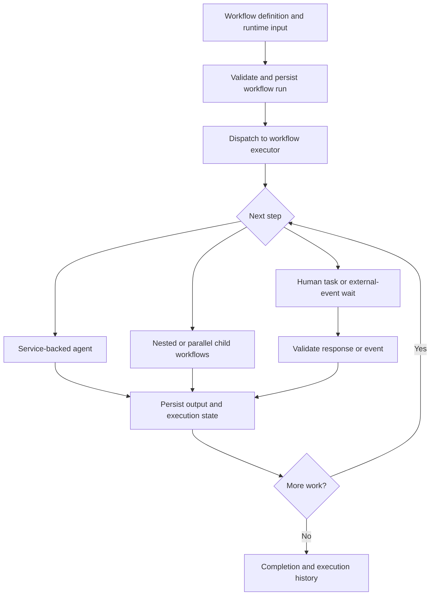

# Custom workflow engine

[Platform overview](README.md) | [RetiPlatform home](../README.md)

The workflow engine is a custom Python implementation for persistent business processes. It separates **what a process does** from **how each capability is implemented**: a definition composes reusable agents, an executor advances the process, backend services perform the business operations, and persisted records describe the work completed or still waiting.

An agent is a reusable capability adapter; it does not have to invoke an AI model. Document requests, deterministic form generation, notifications, and HTTP data acquisition can participate alongside model-assisted work. This lets a process use ordinary application logic where the answer is known and AI where interpretation adds value.

## Definition and execution examples

The application provides two complementary views of a workflow: a **definition view** for inspecting its reusable structure, and an **execution view** for examining the recorded state of a run. The examples below show both views for client onboarding and the EB-2 PERM process.

| View | What it shows | Question it answers |
| --- | --- | --- |
| **Definition** | Configured agents, nested workflows, parallel blocks, branches, human checkpoints, event waits, and selected-node properties or JSON. | How is the process composed, and what paths can it take? |
| **Execution** | A sample run's parent/child hierarchy, per-step status, start/completion dates, duration, and messages. | What state does this run report for each step? |

A definition can be reused with different runtime inputs. Each execution records the progress of an individual run; inspecting a configured step is separate from observing that step execute.

### Client onboarding

**Definition view.** The onboarding definition groups company setup and user setup in a parallel block, followed by membership, database and product provisioning, local records, role assignment, and account activation. A switch defines the email branches for different activation states. The properties panel exposes the selected nested workflow's reference, parameters, and JSON configuration.

[Open the client-onboarding definition at full size](../assets/client_onboard_workflow_def.png).

**Execution view.** The sample run shows a completed parent workflow with nested company-setup and user-setup workflows. Its visible steps cover company and user records, company membership, database provisioning, product setup, role assignment, and an access-ready email step. The monitor adds recorded statuses and timing to the process hierarchy.

[Open the client-onboarding execution at full size](../assets/client_onboard_workflow.png).

### EB-2 PERM workflow

**Definition view.** This longer process composes parallel beneficiary, employer, and attorney intake subflows with prevailing-wage preparation, recruitment, and PERM form preparation. Human review checkpoints and external-event waits are visible alongside reusable agents. The hierarchy continues through I-140, visa-bulletin, and I-485 package-preparation stages. The selected agent's properties show its execution reference, parameter bindings, and JSON configuration.

[Open the EB-2 PERM definition at full size](../assets/eb2_perm_workflow_def.png).

**Execution view.** The development run presents the process as a hierarchy of workflow and agent records, with individual statuses and timing across intake, preparation, review, and later immigration stages.

The capture includes **Completed** steps alongside review and event-wait steps labeled **Not Started**. Those labels preserve the monitor's reported state for the sample; the screenshot is an execution-interface example, not evidence of a completed government filing.

[Open the EB-2 PERM execution at full size](../assets/eb2_perm_workflow.png).

## Engine execution model

The following diagram is a conceptual view of the engine, rather than a deployment map:

## Definitions, data, and composition

| Capability | Implemented behavior |
| --- | --- |
| Declarative definitions | JSON definitions describe a workflow's name, description, version metadata, inputs, tasks, and output mapping. Registered definitions can be loaded from repository assets or object storage. |
| Input contracts | Required-field and basic top-level type checks reject unsuitable input before execution. |
| Context and parameter binding | Steps consume original inputs, earlier step results, and the current item within a loop; outputs become available to later work. |
| Sequential execution | Ordered steps compose a process from smaller capabilities. |
| Conditional routing | If/else branches and exact-match switch branches, including defaults, select the next work from runtime data. |
| Collection processing | Serial loops repeat a task sequence over a collection. |
| Concurrent execution | Parallel task blocks run independent work concurrently. |
| Nested workflows | A workflow can call another reusable workflow with explicit inputs and mapped results, retaining parent/child relationships. |
| Durable parallel children | Child workflow identities and parent join state are persisted. Children can pause independently; the parent continues when all children complete. |
| Reusable service adapters | Agents expose focused business capabilities through the service layer, allowing the same underlying behavior to serve workflows and APIs. |

Definitions express a reusable process; people, organizations, and other run-specific facts enter as runtime data. This supports different business scenarios without embedding a particular client's information in a workflow template.

## Human work and external events

Long-running processes need explicit waiting states. A document request or attorney review should remain meaningful after the user closes a browser.

- **Persistent human tasks:** a checkpoint can carry a role, an optional named assignee, an action, a UI form, instructions, a due date, and input/output data.
- **Controlled completion:** task completion checks the assigned reviewer, actionable state, and expected output. Required approval checkpoints cannot simply be skipped.
- **Artifact-specific review:** selected form and package review services bind a decision to the saved artifact being reviewed, keeping the approval connected to that version of the work.
- **External-event waits:** a process can wait for a specified event and check its type, source, matter, actor, owner, and required payload values before continuing.
- **Duplicate-event handling:** event acceptance and rejection are recorded, and repeated deliveries are detected, helping prevent a repeated notification from advancing the same wait twice.
- **Workflow-driven communication:** reusable email and document-request capabilities support template selection, conditional send/skip decisions, and delivery results. Document requests include suppression of unchanged requests and an explicit resend path.

## Execution, persistence, and recovery

The API persists a workflow instance before dispatching work to a separate executor. Dispatch adapters support local HTTP execution and Google Cloud Tasks. The executor has concurrency limits and reports active and waiting capacity.

Persistent workflow and task records carry inputs, outputs, status, timestamps, errors, execution identity, parent/root tracking, and relevant company, product, and matter context. Atomic execution claims and state checks guard against concurrent delivery, already-running instances, and inappropriate advancement of paused or terminal work.

Recovery is explicit and capability-specific. Implemented paths include retrying an initial dispatch, recovering selected children that have not started, and assessing supported deterministic preparation retries against retained attempt, version, and content-hash evidence. These paths preserve the workflow identity so recovery remains connected to the original run.

## Visual exploration and monitoring

The application provides a workflow explorer and execution monitor:

- Searchable, paginated workflow definitions with expandable nested task trees.
- Condition and branch inspection, per-node properties, input details, and a JSON view.
- Workflow start and refresh controls.
- Workflow and agent execution lists with status, timestamps, errors, and final messages.
- Root-only or all-instance views, tracking-based drilldown, hierarchical execution trees, and graph views.
- Matter-specific workflow queries that connect a business record to its running processes.

The active interface emphasizes inspection, starting work, and understanding execution. A complete visual authoring and publishing experience is a separate development direction.

## Applying the engine to legal work

An illustrative process is: collect matter inputs, request missing documents, wait for the client's response, extract relevant information, prepare a form, obtain attorney review, and continue to the next approved step. The engine provides the composition and waiting mechanisms; domain services define the documents, data requirements, permissions, and review rules.

Concrete reusable capabilities already exist for onboarding, document requests, form generation, and notifications. Broader immigration workflows continue to be integrated and validated. A workflow definition by itself is not evidence that every legal step or external filing is automated.

**Current engine boundaries:** durable parallel child workflows use a wait-for-all join; collection loops run serially. Recovery supports defined continuation paths, rather than arbitrary replay from any failure. Version metadata does not imply immutable version pinning for every run. A general recurring scheduler, configurable automatic retry/backoff policy, and complete no-code publishing are not claimed as delivered capabilities.
